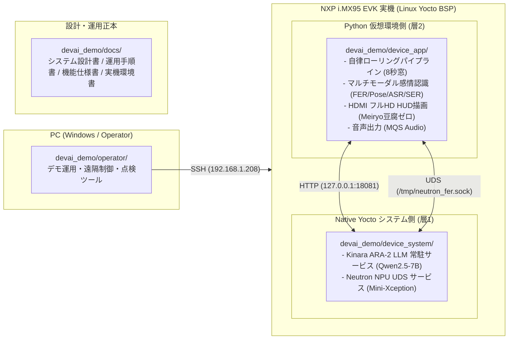

# 11月実機展示デモ 集約パッケージ (`devai_demo`)

**最終更新:** 2026-10-26 (Asia/Tokyo)  
**対象環境:** NXP i.MX95 EVK + Kinara ARA-2 M.2 + Linux Yocto BSP + PC (Windows / PowerShell)  
**リポジトリ:** [multimodal-emotion-analyzer (GitHub)](https://github.com/buildko89/multimodal-emotion-analyzer.git)  
**目的:** 過去の膨大な試行錯誤・実験資産から、**「11月展示デモの成立・運用に真に必要なスクリプト・ドキュメント・実機実装物」を抽出し、一元集約・体系化**したパッケージです。

> [!IMPORTANT]
> **今後の開発・管理ルール（ユーザー指示・2026-10-26）:**
> 1. **バージョン番号の固定（V25 Fix）:** バージョン番号は「V25」でFixします。以後はV25をベースとして改善を進め、バージョンフォルダを際限なく増やしません。
> 2. **GitHub 一元管理:** ファイル増加による管理混乱を防ぐため、本集約パッケージおよびアプリケーション本体は [`multimodal-emotion-analyzer` GitHub リポジトリ](https://github.com/buildko89/multimodal-emotion-analyzer.git) でソースコードとドキュメントを一元管理します。

---

## 1. 「何が必要か？」の整理と全体マップ

これまで ARA01 から ARA14 まで積み重ねられたファイル群のうち、**11月の本番デモで実際に稼働・運用するコア資産**は以下の **4大カテゴリ** に集約されます：



---

## 2. ディレクトリ構成と役割一覧

| ディレクトリ | 役割 | 含まれる主要な資産 |
|---|---|---|
| [`docs/`](docs/) | **デモ仕様・運用の正本ドキュメント** | `01_DEMO_ARCHITECTURE.md` (全体設計書)<br>`02_DEMO_RUNBOOK.md` (当日運用手順書)<br>`03_EXHIBITION_SPEC.md` (感情認識・HUD・対話仕様)<br>`04_DEVICE_ENVIRONMENT.md` (実機環境・接続設定)<br>`05_VERIFICATION_HISTORY.md` (実機実証実績) |
| [`operator/`](operator/) | **PC側オペレーター・運用スクリプト**<br>(実機へSSH接続してデモを起動・監視・回収) | `ara_demo_continuous_operator.py` (自律連続稼働オペレーター)<br>`ara_demo.py` (リリース構築・配備・境界値チェック)<br>`ara_demo_image_operator.py` (静止画テスト用)<br>`ara_demo_evidence_offload.py` (ログ回収・退避)<br>`ara_audio_devices.py` (音声デバイス点検) |
| [`device_system/`](device_system/) | **実機 Native Yocto 側常駐サービス**<br>(OS起動時にバックグラウンド常駐) | `services/ara-llm.service` (systemd ユニットファイル)<br>`services/ara_llm/` (Kinara Qwen2.5-7B 常駐推論サービス)<br>`npu/` (Neutron NPU UDS サービス＆INT8量子化モデル) |
| [`device_app/`](device_app/) | **実機アプリケーション本体**<br>(実機 `/root/devai_ara/<release>/release/` に配備されるコード) | `runtime.py` (実機ライフサイクル・doctor)<br>`config.json` (パイプライン設定・8秒窓)<br>`workspace/assets/` (`meiryo.ttc`, 音声wav, manifest)<br>`workspace/multimodal-emotion-analyzer/` (自律パイプライン本体)<br>`workspace/devai/driver_eval/` (SenseVoice, Emotion2Vec, MediaPipe) |

---

## 3. なぜこの分離が必要なのか？（設計の核心）

1. **Yocto ABI 不整合と SIGSEGV 回避 (UDS IPC 分離):**
   - i.MX95 内蔵 Neutron NPU（`libneutron_delegate.so`）は Yocto システム Python（3.14）専用です。
   - アプリ用仮想環境（Python 3.12 や pip 版 TensorFlow）から直接ロードするとクラッシュするため、`device_system/npu/` のサービスとして分離し、ソケット通信で推論結果のみを受け取ります。
2. **ホストメモリ・Swap 保護 (Kinara ARA-2 常駐 LLM):**
   - Qwen2.5-7B は毎回のアプリ起動でロードすると数分かかり展示に耐えられません。そのため `device_system/services/ara-llm.service` により Native 側で常駐させ（ホストRAM 6.4GB空き、Swap 0KB）、アプリからはポート 18081 経由で超高速に応答を得ます。
3. **実機ストレージ厳格維持 (ローリング窓 ＆ ハードリンク共有):**
   - 実機空き容量は 220MB 前後と極めて逼迫しています。
   - `device_app/` は不変ファイルを前版からハードリンク（`cp -al`）共有して配備し、実行時はパイプラインが直近3窓のみを保持して古い窓を自動パージすることで、**常時連続稼働してもディスク容量が減少しない自律安定性**を実現しています。

---

## 4. デモ運用クイックスタート（最短手順）

PC の PowerShell から以下の通り実行します：

```powershell
# 1. オペレーターフォルダへ移動
cd D:\source\repos\ara\devai_demo\operator

# 2. 実機健全性点検 (Pre-flight Doctor)
python -u ara_demo_continuous_operator.py preflight --release ara_demo_20261026_v25 --session demo_continuous_YYYYMMDD_HHMMSS_preflight

# 3. 自律常時稼働デモの開始 (来場者を迎える)
python -u ara_demo_continuous_operator.py start --release ara_demo_20261026_v25 --session demo_continuous_YYYYMMDD_HHMMSS_run01 --reply "現在、カメラ・マイク入力の準備ができています"

# 実機がreadyになった後、本人へ現在の発話準備を再確認してから連続取得を許可
python -u ara_demo_continuous_operator.py arm --release ara_demo_20261026_v25 --session demo_continuous_YYYYMMDD_HHMMSS_run01 --reply "今から話せます"

# 4. 現在の画面スクリーンショット取得 (確認用)
python -u ara_demo_continuous_operator.py screenshot --release ara_demo_20261026_v25 --session demo_continuous_YYYYMMDD_HHMMSS_run01

# 5. デモの安全停止 (終了時)
python -u ara_demo_continuous_operator.py stop --release ara_demo_20261026_v25 --session demo_continuous_YYYYMMDD_HHMMSS_run01

# 6. ログ・証拠の完全回収
python -u ara_demo_continuous_operator.py collect --release ara_demo_20261026_v25 --session demo_continuous_YYYYMMDD_HHMMSS_run01
```

※ 詳細な手順・トラブルシューティングは [`docs/02_DEMO_RUNBOOK.md`](docs/02_DEMO_RUNBOOK.md) を参照してください。

---

## 5. 今後の継続作業（NEXT_STEP.md との連携）

本 `devai_demo` フォルダを集約したことにより、今後のデモ向け開発・調整・検証はすべてここを正本として進めることができます。

### 次に進めるステップ:
1. **固定リリースV25の8時間連続稼働確認:**
   - ワーカー要求は各backend直近2件、入力窓は直近3件に制限済み。実機でディスク・RAM・処理遅延がフラットに推移することを確認する。
2. **実機入力での応答性確認:**
   - Visualの重いFace/Hand推論を10fps相当から2.5fps相当へ間引き、全フレームの時系列行は維持。実機カメラ・マイクで効果と認識品質を確認する。
3. **展示会本番向けシナリオ・演出の最終チューニング:**
   - 表情・頷き・発話に応じた Qwen2.5-7B の応答文言や HUD アバター演出をブース環境に合わせて微調整。
