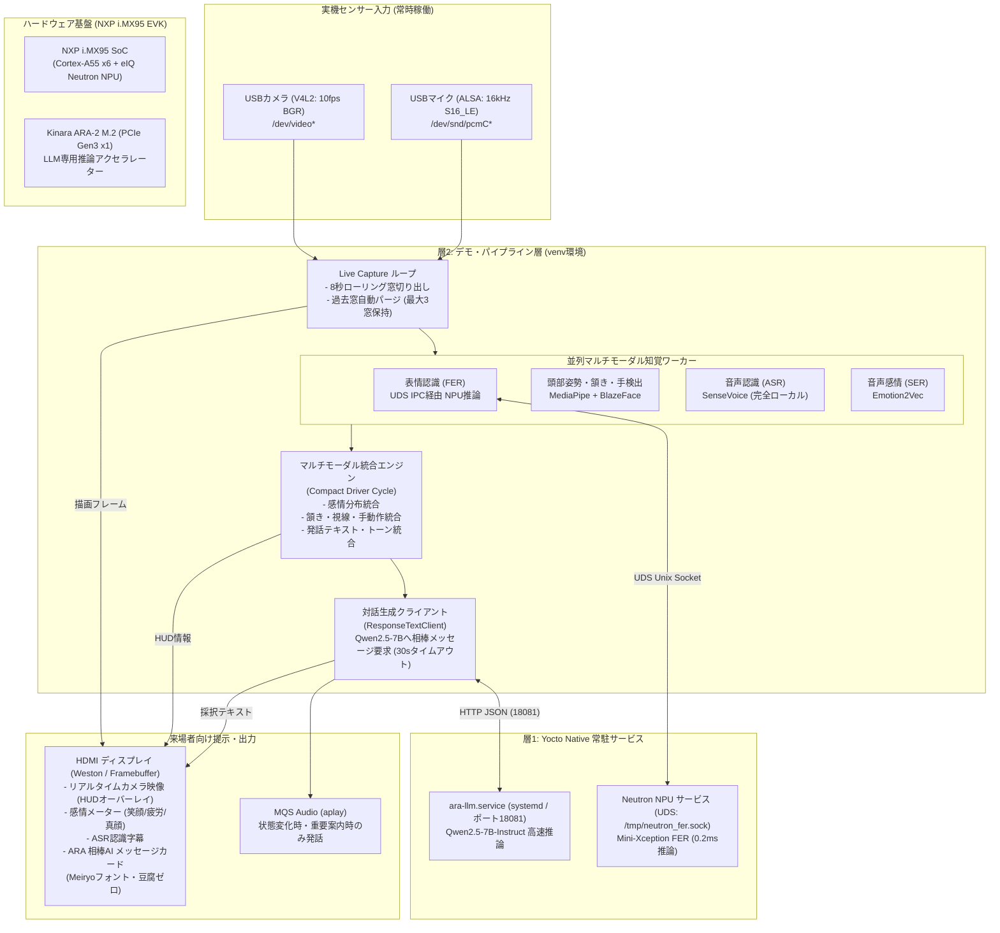

# 11月実機デモ システム全体アーキテクチャ設計書

文書番号: DEVAI-DEMO-ARCH-20261026  
対象環境: NXP i.MX95 EVK + Kinara ARA-2 M.2 + Linux BSP (Yocto) + USBカメラ + USBマイク + HDMIモニター  
位置づけ: 11月中旬の展示会・実機デモ成立に向けたシステム構成・IPC・データフローの正本  

---

## 1. 展示デモの基本思想と要求仕様

### 1.1 自律常時稼働型（Hands-Free Continuous Rolling）
従来の「オペレーターがコマンドを打って10秒カウントダウン後に録画」する手動トリガー方式を完全撤廃。  
展示会場のブースに来場者が立ち止まった瞬間、カメラ・マイクから自律的に表情・頷き・発話を認識し、常駐する Qwen2.5-7B LLM が自然な日本語で対話応答を返し、HDMI ディスプレイにリアルタイム表示します。

### 1.2 実機リソース保護と完全長期安定稼働
- **ストレージ容量保護:** 実機空き容量 214MiB（224,395,264 bytes）を絶対維持。
  - ローリング窓（8秒）方式を採用し、ディスク上には常に最新3窓のみを保持。古い窓は自律パージ。
- **メモリ・プロセス分離（Yocto ABI Isolation）:**
  - i.MX95 内蔵 Neutron NPU は Yocto システム Python（3.14）側の UDS サービスで推論。
  - Kinara ARA-2 上の Qwen2.5-7B は Native 側 systemd サービス（ポート 18081）として常駐（RAM 6.4GB空き、Swap 0KB）。
  - アプリ仮想環境（Python 3.12）から巨大モジュール（`import tensorflow` 等）を排除し、クラッシュやRAM圧迫を根本防止。

---

## 2. システム全体アーキテクチャ構成図

---

## 3. 主要サブシステムの設計仕様

### 3.1 センサー＆ローリング窓パイプライン (`live_pipeline.py`)
- **窓幅:** 8秒固定（展示ブースの来場者の反応時間に最適化）。
- **連続回転:** 起動後は無限ループで窓を切り出し（`live_000001`, `live_000002`, ...）。
- **自律ストレージ保護:**
  - `active_windows` をリング管理し、直近3窓より古いディレクトリは `shutil.rmtree` で即時削除。
  - 実機空き容量が 150MB を切った場合は緊急安全弁（`minimum_disk_headroom`）が働き、リソースを安全解放して停止。

### 3.2 知覚・感情認識ワーカー
1. **表情認識 (FER):**
   - モデル: Mini-Xception (INT8量子化 / Neutron NPU 最適化)
   - 推論時間: 0.2ms以下
   - 分類: 真顔 (Neutral), 笑顔 (Happy), 疲労/悲しみ (Sad), 怒り/緊張 (Angry/Surprise)
2. **頭部姿勢・頷き認識 (Pose):**
   - MediaPipe FaceMesh / BlazeFace による 3D ピッチ・ヨー・ロール角推定
   - 頷き（Nodding）および手による顔覆い（あくび・眠気兆候）を検出
3. **音声認識 (SenseVoice ASR):**
   - 日本語音声を高精度・低遅延（約1.2秒）でテキスト化
   - 外部クラウド不要の完全オンデバイス処理
4. **音声感情認識 (Emotion2Vec SER):**
   - 発話トーンから感情（平静、高揚、疲弊等）を抽出

### 3.3 Kinara ARA-2 常駐 LLM サービス (`ara_llm_service.py`)
- **モデル:** Qwen2.5-7B-Instruct (4-bit 量子化 GGUF)
- **常駐方式:** systemd サービスユニット (`ara-llm.service`) により OS 起動時に自動ロード。
- **リソース配分:** ホスト RAM 6.4GB 確保、Swap 0KB。ARA-2 チップがテンソル演算を肩代わり。
- **対話プロンプト:**
  - 来場者の表情、頷き、発話内容を JSON 構造化して入力。
  - 車載AI相棒としての親しみやすい日本語メッセージ（40文字前後、1〜2文）を高速生成。
  - タイムアウト設定: 30秒（安全採択マージン）。

### 3.4 HDMI HUD 描画エンジン (`live_visual_display.py` / `framebuffer_display.py`)
- **解像度:** 1920x1080 (HDMI フルHD)
- **描画レイアウト:**
  - **左画面:** リアルタイムカメラ映像 ＋ 顔検出ランドマーク ＋ 視線・頭部姿勢ベクトル
  - **右上画面:** ARA 相棒AI ダイナミックアバターバッジ（`● 運転見守り中`）
  - **右ペイン:** 感情・画像認識観測データ（表情分布、手の動作、頭部安定度）
  - **下部ペイン:** ASR 認識字幕 ＆ Qwen2.5-7B 生成メッセージカード
- **フォント:** `meiryo.ttc`（メイリオ）を完全統合し、Linux 上での四角豆腐（□）を完全根絶。

---

## 4. プロセス間通信 (IPC) とネットワーク構成

| 通信経路 | 方式 | プロトコル / エンドポイント | 用途 |
|---|---|---|---|
| PC ⇔ i.MX95 実機 | イーサネット / Wi-Fi | SSH (`root@192.168.1.208:22`) | オペレーターによる遠隔制御・監視・回収 |
| アプリ ⇔ ARA-2 LLM | ローカルループバック | HTTP REST (`http://127.0.0.1:18081`) | 構造化プロンプト送信 ＆ 生成テキスト受信 |
| アプリ ⇔ Neutron NPU | Unix Domain Socket | UDS (`/tmp/neutron_fer.sock`) | 画像テンソル送信 ＆ FER 推論結果受信 |
| アプリ ⇔ 音声出力 | ALSA コマンド | `aplay -D plughw:CARD=MQS` | アナウンス音声再生 |
| アプリ ⇔ ディスプレイ | Framebuffer / Wayland | `/dev/fb0` または Weston IPC | フルHD HDMI HUD描画 |
